# Microsoft Sentinel SOC Detection Lab

A hands-on Security Operations Center (SOC) lab focused on Windows authentication monitoring, security event analysis, and threat detection using **Microsoft Sentinel, Azure Monitor Agent (AMA), Data Collection Rules (DCR), Log Analytics, and Kusto Query Language (KQL)**.

This project demonstrates the collection and analysis of genuine Windows Security Events generated through controlled authentication simulations, including brute-force activity, failed-to-successful login correlation, and account lockouts.

**Project Status: Detection scenarios successfully validated - October 2026**

## Project Overview

The objective of this lab was to simulate common authentication-related security events, collect the resulting Windows logs in Microsoft Sentinel, and develop KQL queries capable of identifying potentially suspicious activity.

The lab covers three primary detection scenarios:

1. **Brute-Force Detection:** Identify multiple failed authentication attempts within a short time window.
2. **Failed-to-Successful Login Correlation:** Detect a successful authentication following repeated failed attempts.
3. **Account Lockout Detection:** Identify Windows accounts locked after exceeding the configured authentication failure threshold.

All three scenarios were successfully demonstrated using genuine Windows Security Events collected from a controlled Azure lab environment.

## Lab Architecture

**Windows Server 2022 VM → Azure Monitor Agent (AMA) → Data Collection Rule (DCR) → Log Analytics Workspace (`SecurityEvent`) → Microsoft Sentinel → KQL Detection Queries**

The environment was deployed using Azure for Students.

| Component | Configuration |
|---|---|
| Cloud Platform | Microsoft Azure |
| SIEM | Microsoft Sentinel |
| Virtual Machine | Windows Server 2025 Datacenter |
| VM Name | `vm-soc-lab` |
| VM Region | Sweden Central |
| Log Analytics Workspace | `law-sentinel-soc-lab` |
| Workspace Region | Canada Central |
| Log Collection | Azure Monitor Agent |
| Data Collection Rule | `dcr-soc-lab-security-events` |
| Log Analytics Table | `SecurityEvent` |
| Collected Event IDs | 4624, 4625, 4740 |
| Detection Language | Kusto Query Language (KQL) |

### Original Architecture Diagram

The following diagram documents the earlier implementation of this lab.

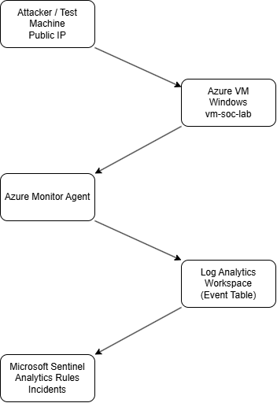

## Security Events Monitored

| Event ID | Description | Security Relevance |
|---|---|---|
| **4624** | Successful account logon | Authentication activity and potential successful access |
| **4625** | Failed account logon | Password guessing and brute-force attempts |
| **4740** | User account locked out | Repeated authentication failures and potential account targeting |

These events were collected from the Windows Security log using Azure Monitor Agent and a Data Collection Rule.

## Detection Rules

The repository includes three KQL detection files.

| Rule | Detection | KQL File |
|---|---|---|
| R1 | Brute-Force Detection | [rule1_bruteforce_4625.kql](kql/rule1_bruteforce_4625.kql) |
| R2 | Failed-to-Successful Login Correlation | [rule2_failed_then_success_4625_4624.kql](kql/rule2_failed_then_success_4625_4624.kql) |
| R3 | Account Lockout Detection | [rule3_account_lockout_4740.kql](kql/rule3_account_lockout_4740.kql) |

**Validation note:** The detection scenarios below were successfully tested through manually executed KQL queries against the `SecurityEvent` table. The exact revised KQL files linked above have not yet been independently verified against the new environment. Their original implementation may use different field names, parsing logic, or thresholds.

### Detection 1 — Brute-Force Authentication Attempts

**MITRE ATT&CK:** T1110 — Brute Force

**Objective:** Identify repeated failed authentication attempts against a Windows account within a short period.

**Detection Logic:**

- Monitor Windows Event ID 4625.
- Group failed logins by account and computer.
- Count failed authentication attempts within five-minute intervals.
- Identify groups containing at least five failed attempts.

**Test Procedure:**

A temporary local Windows account named `soclabtest` was created on the Azure VM.

Six consecutive authentication attempts were executed using deliberately incorrect credentials through the Windows authentication API.

Windows generated six corresponding Event ID 4625 records, which were forwarded to Log Analytics.

**Observed Results:**

| Field | Value |
|---|---|
| Account | `vm-soc-lab\soclabtest` |
| Computer | `vm-soc-lab` |
| Event ID | 4625 |
| Failed Attempts | 6 |
| Detection Threshold | 5 failures |
| Detection Window | 5 minutes |
| Outcome | Successfully detected |

**Detection Evidence:**

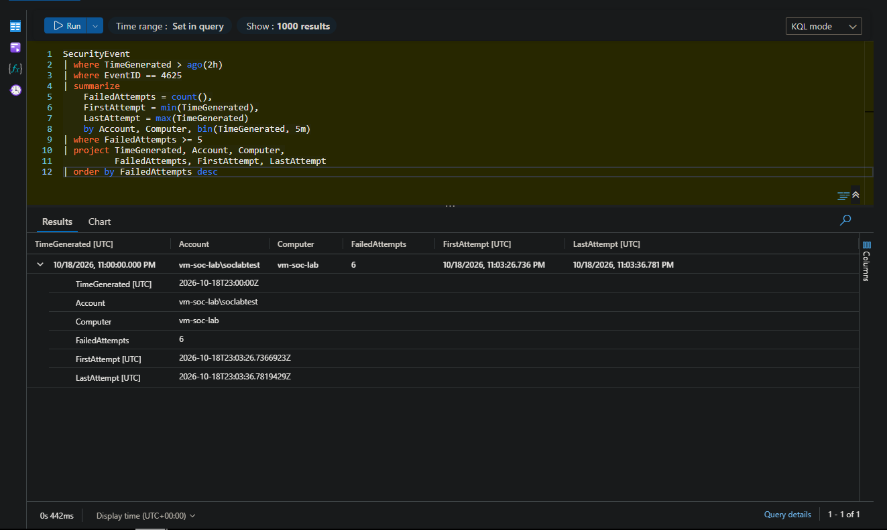

The query successfully identified six failed authentication attempts occurring within approximately ten seconds.

This demonstrates how KQL aggregation and time-based thresholds can identify simulated password-guessing activity.

### Detection 2 — Failed-to-Successful Login Correlation

**MITRE ATT&CK:** T1110 — Brute Force, as a potential preceding technique

**Objective:** Identify accounts that experience repeated failed authentication attempts followed by a successful login.

This sequence may indicate that a password-guessing attempt eventually succeeded, although it is not sufficient by itself to establish account compromise.

**Detection Logic:**

- Monitor Event ID 4625 for failed authentication attempts.
- Monitor Event ID 4624 for successful authentication.
- Normalize and correlate usernames and computer names.
- Identify successful authentication occurring within 30 minutes after the most recent failure.

**Test Procedure:**

Following the simulated failed authentication attempts, a successful authentication was performed using valid credentials for the same test account.

Windows generated Event ID 4624, and the event was successfully forwarded to Log Analytics.

A KQL correlation query was executed to identify the relationship between the failed and successful authentication events.

**Observed Results:**

| Field | Value |
|---|---|
| Account | `soclabtest` |
| Computer | `vm-soc-lab` |
| Failed Authentication Events | 7 |
| Successful Authentication Events | 1 |
| Last Failed Authentication | 11:03:36 PM UTC |
| Successful Authentication | 11:10:27 PM UTC |
| Time Between Events | Approximately 6 minutes 50 seconds |
| Outcome | Successfully correlated |

**Detection Evidence:**

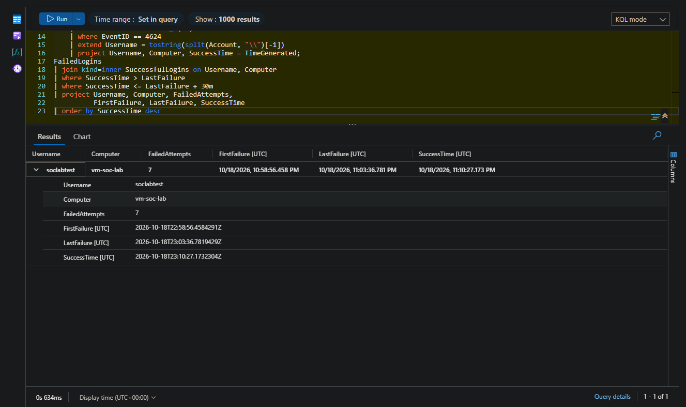

The query successfully correlated seven failed authentication events with a subsequent successful login for the same account and computer.

This demonstrates the use of KQL joins, timestamps, and event correlation to identify authentication sequences that may warrant investigation.

### Detection 3 — Account Lockout Monitoring

**MITRE ATT&CK:** T1110 — Brute Force, as a possible cause of repeated authentication failures

**Objective:** Identify Windows account lockouts caused by repeated failed authentication attempts.

**Detection Logic:**

- Monitor Windows Event ID 4740.
- Extract the affected account, computer, and event timestamp.
- Surface lockout activity for further investigation.

**Test Procedure:**

The local Windows account lockout policy was configured with a threshold of five failed authentication attempts.

Eight incorrect authentication attempts were executed against the temporary `soclabtest` account.

Windows generated an account lockout event, which was forwarded to Microsoft Sentinel.

**Observed Results:**

| Field | Value |
|---|---|
| Target Account | `vm-soc-lab\soclabtest` |
| Computer | `vm-soc-lab` |
| Event ID | 4740 |
| Activity | A user account was locked out |
| Lockout Threshold | 5 failed attempts |
| Outcome | Successfully detected |

**Detection Evidence:**

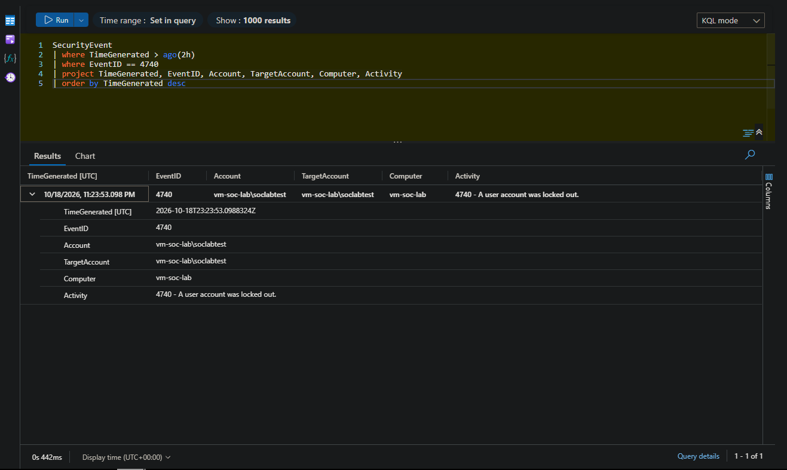

The results confirmed that Event ID 4740 was generated on the Windows VM and successfully ingested into Log Analytics.

This demonstrates the ability to monitor Windows account lockout activity using Microsoft Sentinel.

## Windows Security Event Collection

Before testing the detection scenarios, the logging pipeline was validated by confirming that Windows Security Events were being collected and forwarded into the Log Analytics workspace.

The Data Collection Rule was configured to collect:

- Event ID 4624 — Successful logons
- Event ID 4625 — Failed logons
- Event ID 4740 — Account lockouts

### Failed Authentication Event Evidence

The following screenshot confirms that Event ID 4625 was successfully ingested into the `SecurityEvent` table.

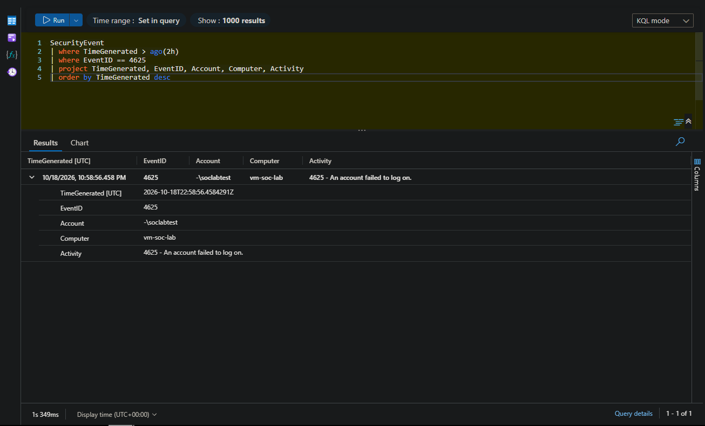

This validated the underlying event collection pipeline before executing the more advanced detection queries.

## Detection Validation Summary

| Detection Scenario | Test Method | Observed Result | Status |
|---|---|---|---|
| Security Event Collection | Generate Windows authentication activity | Events received in Log Analytics | Passed |
| Brute-Force Detection | Six incorrect password attempts | Six failures identified within five minutes | Passed |
| Failed-to-Successful Correlation | Failed attempts followed by valid authentication | Seven failures correlated with one success | Passed |
| Account Lockout Detection | Repeated invalid authentication attempts | Event ID 4740 generated and ingested | Passed |

**Scope of validation:** These results confirm manual KQL detection testing against genuine Windows Security Events generated in a controlled lab. They do not demonstrate that the exact revised repository queries were executed unchanged, that scheduled analytics rules were deployed in the rebuilt workspace, or that automated alerts and incidents were generated.

The test results are evidence of detection logic functioning under controlled conditions, not production detection accuracy or coverage.

## Original Lab Implementation

Before rebuilding the environment in October 2026, an earlier version of the lab was used to explore simulated RDP authentication failures, Microsoft Sentinel analytics, and incident investigation.

The following screenshots are retained to document that earlier implementation.

They should not be interpreted as evidence of the revised detection queries or the newly rebuilt environment.

| Original Evidence | Screenshot |
|---|---|
| Rule 1 Configuration | 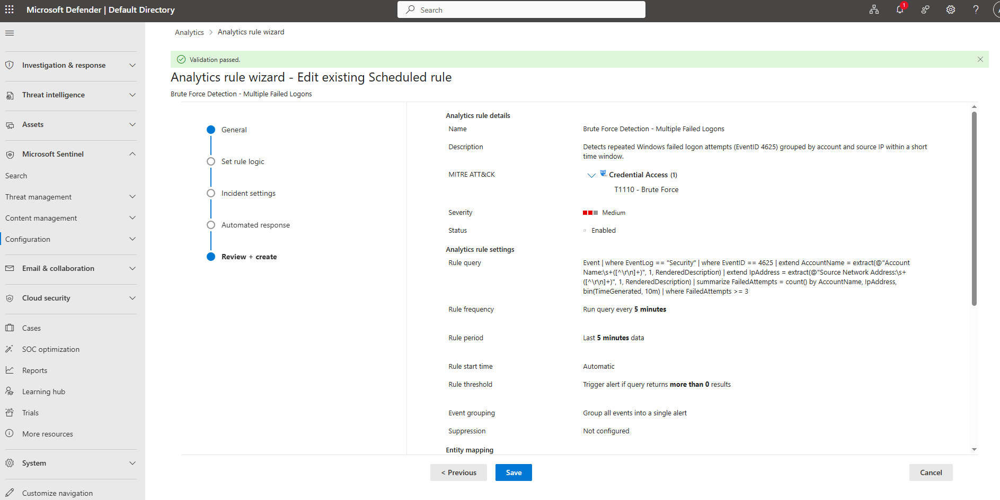 |
| Rule 2 Configuration | 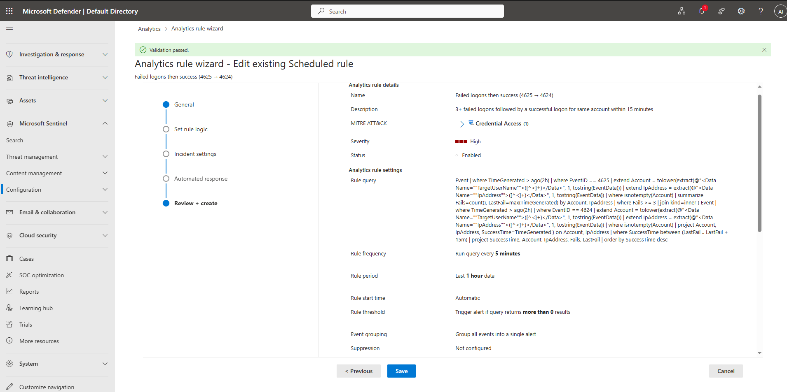 |
| Rule 3 Query | 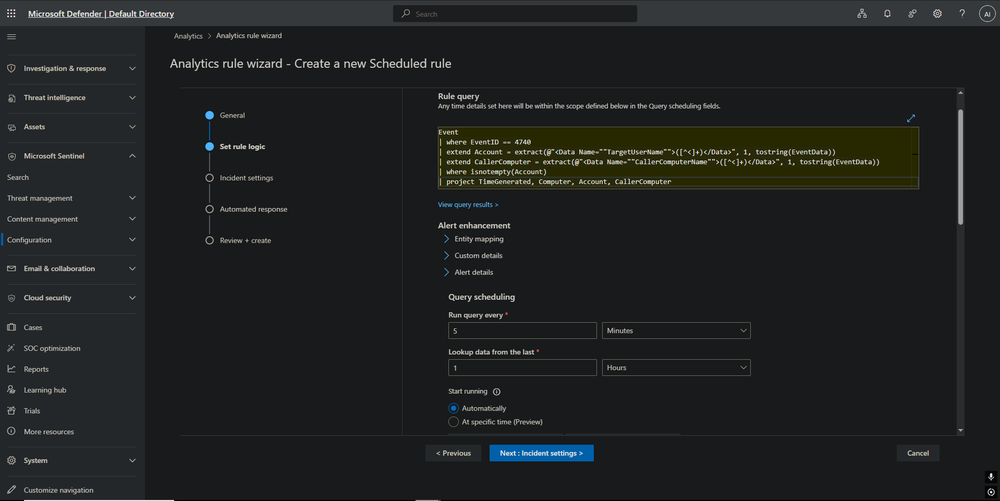 |
| Rule 3 Entity Mapping | 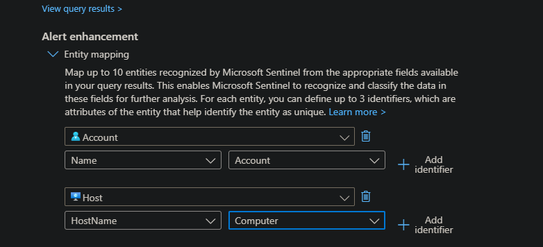 |
| Original Query Results | 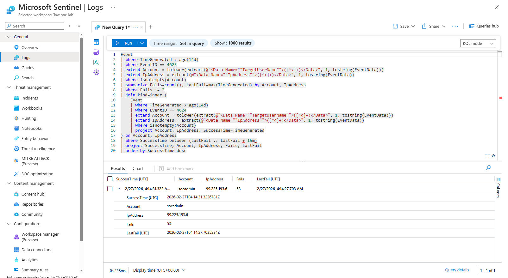 |
| Original Sentinel Incident | 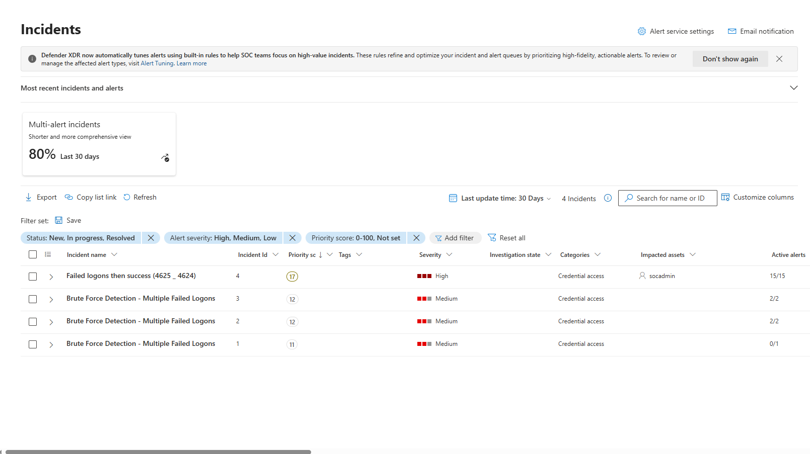 |

## SOC Analyst Workflow

The lab demonstrates several foundational security operations activities:

1. **Log Collection:** Configure Windows Security Event collection using Azure Monitor Agent and Data Collection Rules.
2. **Event Analysis:** Investigate authentication activity through the `SecurityEvent` table.
3. **Detection Development:** Use KQL filters, aggregation, time windows, and joins to identify suspicious authentication patterns.
4. **Threat Investigation:** Examine affected accounts, event timestamps, and authentication sequences.
5. **Detection Validation:** Simulate authentication activity and compare expected behavior against observed query results.
6. **Documentation:** Record detection logic, test methodology, and supporting screenshots.

### Investigation Considerations

In a real SOC environment, authentication alerts would require additional context before determining whether malicious activity occurred.

Relevant investigation factors include source IP addresses, account privileges, logon types, asset criticality, historical authentication patterns, and any related endpoint or identity alerts.

Repeated failed logins may be caused by legitimate user mistakes, stale credentials, or misconfigured services. A successful login after failures is suspicious context, not proof of compromise.

## Documentation

The following documents provide additional technical details about the lab implementation, detection validation, and security investigation procedures.

- [Detection Validation Matrix](docs/detection-validation-matrix.md) — Documents the authentication detection scenarios, testing methodology, and validation results.
- [SOC Incident Response Guide](docs/incident-response-guide.md) — Outlines investigation and response procedures for suspicious Windows authentication activity.
- [Lab Environment Details](docs/lab_environment_details.md) — Describes the Azure infrastructure, security event collection, and Microsoft Sentinel configuration.

## Skills and Technologies

**Security Operations:** SIEM monitoring, Windows authentication analysis, detection engineering fundamentals, security event correlation, SOC investigation workflows.

**Microsoft Azure:** Microsoft Sentinel, Azure Monitor Agent, Data Collection Rules, Log Analytics, Azure Virtual Machines.

**Querying and Analysis:** Kusto Query Language (KQL), event filtering, aggregation, time-based detection, joins, and security log analysis.

**Security Concepts:** Brute-force detection, account lockout monitoring, authentication anomaly investigation, MITRE ATT&CK mapping, and detection validation.

## Future Improvements

- Verify and align the revised repository KQL files with the queries successfully tested in the rebuilt workspace.
- Deploy validated KQL detections as scheduled Microsoft Sentinel analytics rules.
- Configure appropriate entity mappings, alert grouping, and suppression settings.
- Generate and investigate alerts and incidents produced by the deployed rules.
- Add source IP correlation where supported by the collected event fields.
- Evaluate detection false positives and perform additional positive and negative tests.
- Complete an evidence-backed incident investigation case study.

## Conclusion

This project demonstrates the implementation and validation of a cloud-based Windows authentication monitoring lab using Microsoft Sentinel.

Through controlled authentication simulations, the lab successfully generated and collected Windows Security Events associated with failed logins, successful logins, and account lockouts.

Manual KQL detection queries identified repeated failed authentication attempts, correlated failed-to-successful login sequences, and surfaced account lockout activity.

The project provided practical experience with Azure security monitoring, SIEM log collection, KQL detection development, event correlation, and documenting security investigation evidence.

---

**Author:** Ashkon Irani

**Project:** Microsoft Sentinel SOC Detection Lab

**Last Updated:** October 2026
